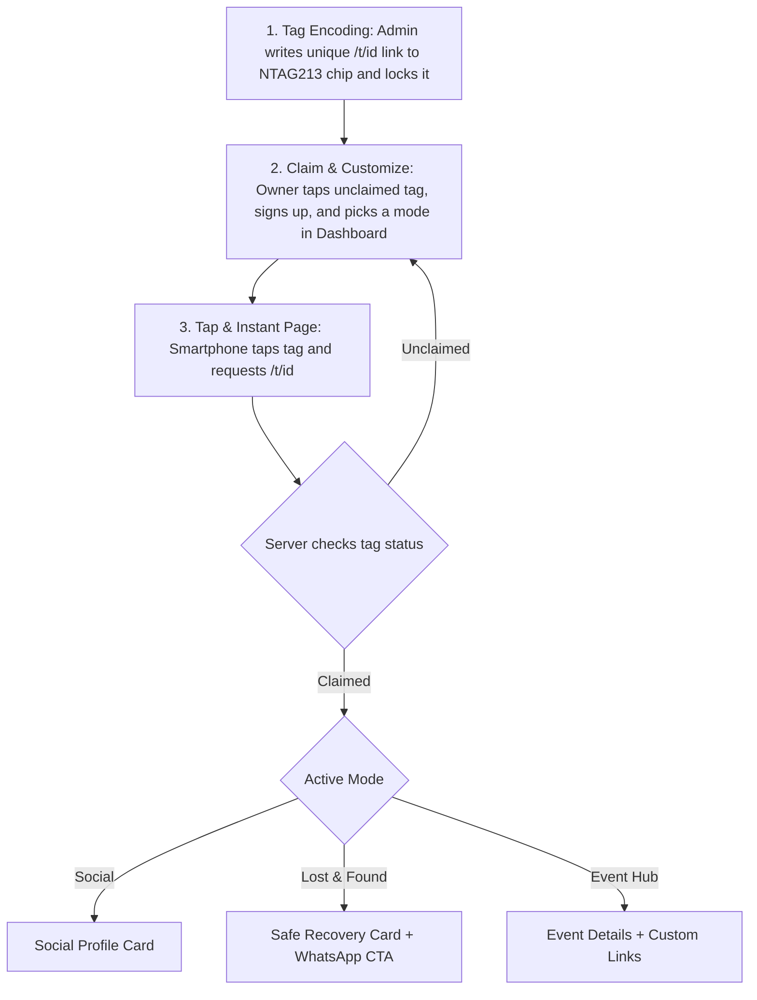

# Verto


> **One physical NFC tag, three switchable digital modes.** Share your socials, protect everyday belongings, or host event links straight in any phone browser with zero app downloads.

- 🌐 **Live Deployment:** : ["Verto"](https://verto.vercel.app)
- 🎬 **Promotional Video:** ["Promotional Video"]https://youtu.be/w70QcK9f5oE?si=yXmYmYmYmYmYmYmY

---

## 💡 About & The Problem

Everyday interactions on campus and beyond run into three recurring snags:

- **Slow networking:** Typing usernames, spelling handles, and searching profiles slows down quick student and event introductions.
- **Lost everyday items:** Keys, tumblers, helmets, and laptops get misplaced easily. Writing a personal phone number on a sticker exposes private contact info permanently, while Bluetooth trackers cost too much for everyday gear.
- **App-install friction:** Nobody wants to download a dedicated app just to scan someone's tag, and standard NFC chips lock you into a single static link unless you rewrite them manually.

**How Verto solves it:** Verto pairs affordable **NTAG213** hardware (**Anti-Metal Stickers** for phones and laptops, and **ABS Coin Keychains** for keys and bags) with dynamic web routing (`/t/[id]`). Each physical tag is encoded and locked once during production. Tapping the tag opens a fast mobile page in any phone browser, while the owner switches what that tag displays anytime from the Verto dashboard.

---

## ✨ Core Modes & Features

- 👤 **Social Mode:** A digital profile card displaying your avatar, bio, WhatsApp, Instagram, and LinkedIn links in a single tap.
- 🛡️ **Lost & Found Mode:** A safe recovery page for personal items with an optional item photo, return instructions, and a **Contact Owner** button that opens a pre-filled WhatsApp chat.
- 📅 **Event Hub Mode:** A mobile landing page for campus seminars, booths, and workshops with event details and up to three custom links.
- 🏷️ **Multi-Tag Dashboard:** Claim new physical tags simply by tapping them, label and manage multiple tags under one account, and get started with a guided onboarding tour.
- 🎨 **Live Theme Studio:** Customize fonts, accent colors, light or dark mode, and background patterns while previewing changes inside a miniature phone frame before saving.
- 🔄 **Safe Tag Transfer & Direct Ordering:** Unclaim a tag anytime to gift or pass it on (automatically clearing your personal data), and order hardware straight from the landing page via WhatsApp.

---

## 🛠️ Tech Stack

| Layer | Technology | Role |
|---|---|---|
| **Hardware** | `NTAG213 NFC Tags` | Anti-Metal stickers and ABS Coin keychains pre-encoded with unique `/t/[id]` links |
| **Frontend & Backend** | `Next.js (App Router) & TypeScript` | Mobile-first dashboard, server-side `/t/[id]` dynamic routing, and instant tag pages |
| **Database, Auth & Storage** | `Supabase` | User authentication, tag ownership, live mode settings, and custom photo storage |
| **Styling & Motion** | `Tailwind CSS, Framer Motion, Lottie` | Responsive interface, Red Panda mascot animations, and interactive onboarding |
| **Deployment** | `Vercel` | Edge routing and cloud hosting |

---

## 🔄 System Architecture



---

## 📂 Project Structure

```text
verto-app/
├── app/         # Pages, dynamic /t/[id] tag routing, user dashboard, and API routes
├── components/  # Reusable UI elements, dashboard editors, and public tag views
├── lib/         # Supabase connectors, theme presets, and input validation helpers
├── public/      # Brand logos, Red Panda mascot avatars, animations, and SVG patterns
├── supabase/    # Database schema migrations and privacy cleanup rules
└── types/       # Shared TypeScript definitions for users, tags, and modes
```

---

## 🎓 Project Context

Verto was built as an MVP for a **Venture Creation** course, combining physical NFC hardware with a free companion web platform.

